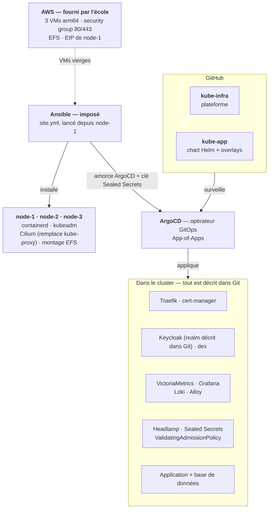
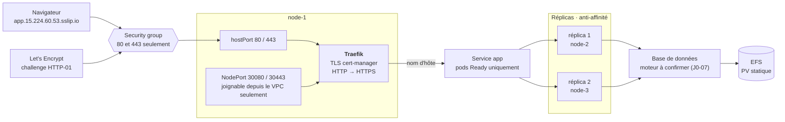
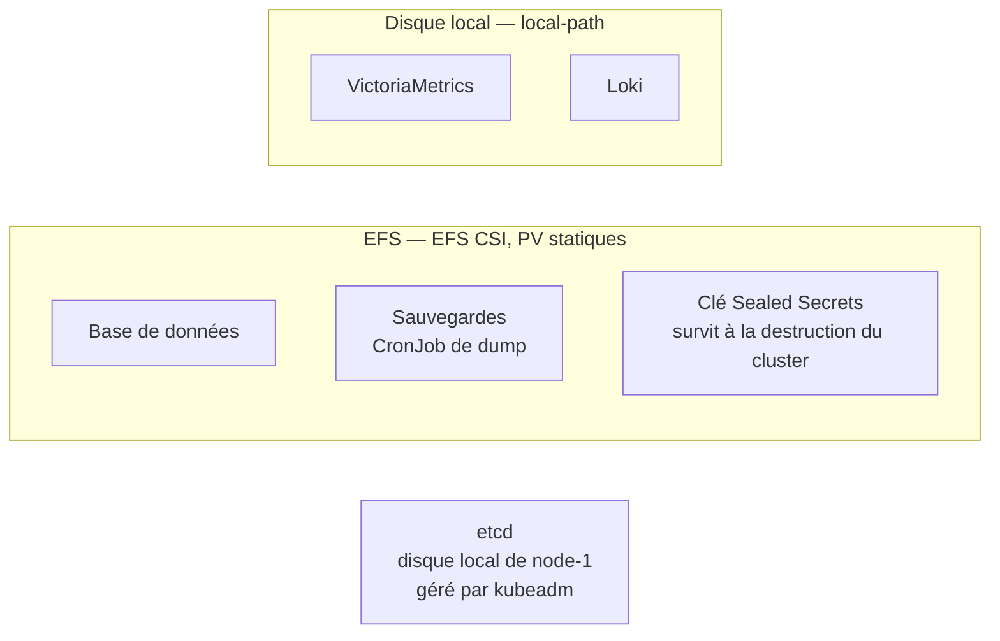
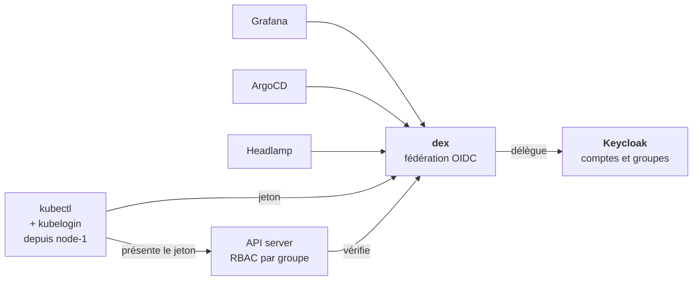
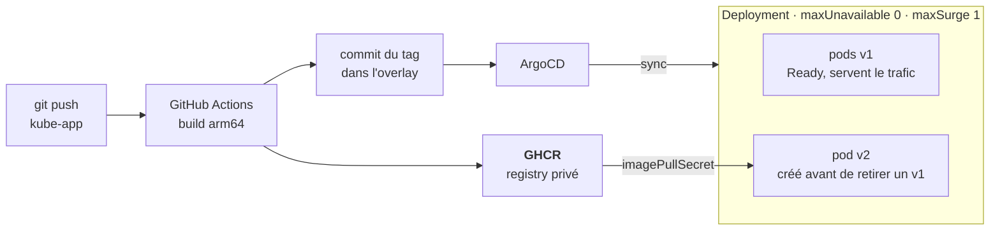

# Architecture — v1

Schéma d'architecture du cluster, repris du manuel d'équipe (« Équipage Kube », section
Architecture) et adapté aux arbitrages actés en J0 (KUB-66).

> **Statut : v1, à valider par les cinq en réunion.** Toute décision qui change ici
> passe d'abord par un ADR dans `docs/adr/`.

Les machines sont nommées `node-1`, `node-2`, `node-3`, comme dans l'inventaire Ansible
et dans Kubernetes. Le sujet et le manuel les appellent `kube-1`, `kube-2`, `kube-3` :
ce sont les mêmes.

| Machine | IP privée | IP publique | Rôle |
|---|---|---|---|
| `node-1` | 10.0.0.80 | 15.224.60.53 (EIP fixe) | control-plane + worker, point d'entrée HTTP/HTTPS, control node Ansible |
| `node-2` | 10.0.0.17 | change à chaque démarrage, jamais utilisée | worker |
| `node-3` | 10.0.0.143 | change à chaque démarrage, jamais utilisée | worker |

---

## 1. Qui fait quoi

Deux outils, deux responsabilités. Pas de Terraform (ADR-001) : l'infrastructure AWS est
fournie par l'école, et le compte ne permet pas de la créer ni de la modifier.

Ansible transforme trois VMs vierges en cluster, puis installe ArgoCD. À partir de là,
plus rien n'est installé à la main : ArgoCD applique tout ce qui est décrit dans les deux
dépôts. La configuration du realm Keycloak suit le même chemin.

---

## 2. Le chemin d'une requête

Tout entre par `node-1`, seul nœud à IP publique fixe : c'est ce qui garde les noms
`sslip.io` et les certificats valides d'un jour à l'autre.

- **hostPort 80/443** : le seul chemin public. Le security group de l'école n'ouvre que
  ces deux ports, et Let's Encrypt valide le certificat sur le port 80.
- **NodePort 30080/30443** : exigé par le sujet. Il mène au même Traefik, mais n'est
  joignable que depuis l'intérieur du VPC.
- Les workers ne sont jamais adressés de l'extérieur. Leurs IP privées sont stables : les
  liens entre nœuds tiennent après chaque redémarrage.
- Les données de la base survivent au redémarrage de son pod parce qu'elles sont sur EFS.

---

## 3. Le stockage

- **EFS** pour ce qui doit survivre à un pod, à un nœud ou à une reconstruction du
  cluster. Les volumes sont créés à l'avance (PV statiques) : le compte ne permet pas d'en
  créer dynamiquement.
- **local-path** pour les métriques et les logs. Ces composants font des `fsync` en continu
  sur de petits blocs, ce qui risque de corrompre leurs données sur NFS (voir §6 de
  `contraintes-et-outillage.md`).
- **etcd** reste sur le disque de `node-1`, jamais sur le réseau.

---

## 4. Une seule identité pour tout

Chaque outil parle OIDC à dex, qui délègue la connexion à Keycloak. Pour `kubectl`,
kubelogin récupère un jeton dex et l'API server le vérifie avant d'appliquer les droits
RBAC du groupe. Le port 6443 n'est pas ouvert depuis Internet : la démonstration
`kubectl` se fait depuis une session SSM sur `node-1`.

---

## 5. Livrer une nouvelle version

Avec `maxUnavailable: 0`, Kubernetes ne retire un pod v1 qu'une fois qu'un pod v2 est
Ready. Si la v2 est cassée, sa readiness probe échoue : le rollout reste bloqué, le Service
ne lui envoie aucun trafic, et les utilisateurs ne voient rien. C'est la démonstration
demandée par le sujet.

Le registry est GHCR : rien à héberger dans le cluster, donc ni RAM ni stockage EFS
consommés. Les nœuds sont en arm64 : l'image doit être construite pour
`linux/arm64`.
